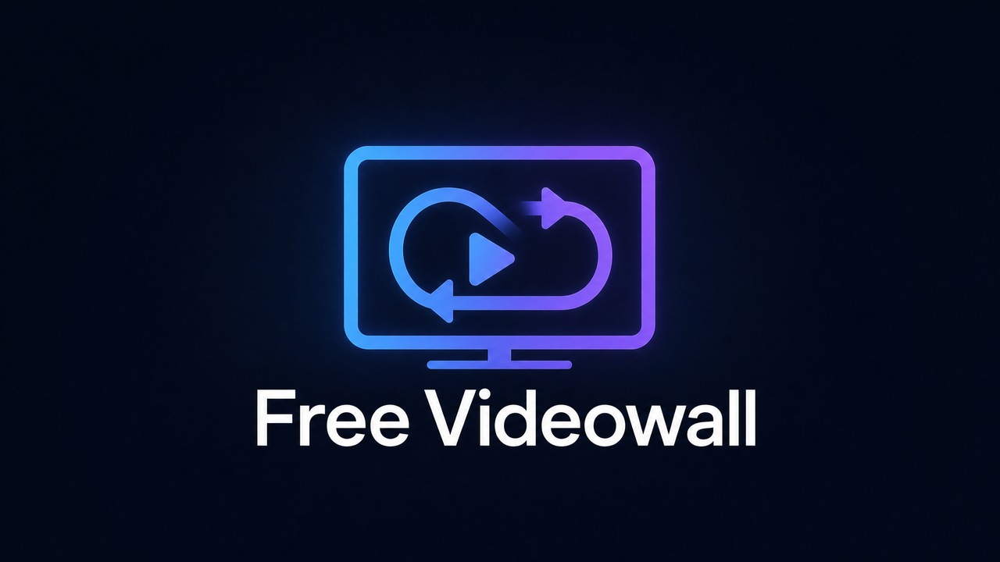

# Free Videowall



**Dein USB-Stick. Deine Playlist. Einfach abspielen.**

Ein kostenloser, quelloffener USB-Player für Videos und Bilder auf Roku-Geräten mit USB-Medienunterstützung. Keine Menüs. Keine Werbung. Kein Benutzerkonto in der App. Dateien und eine M3U auf den Stick kopieren, App öffnen – die Wiedergabe läuft in Endlosschleife.

**Entwicklungsversion:** noch nicht im Roku Streaming Store. Die Installation benötigt derzeit den Roku-Entwicklermodus. [Vorschau herunterladen](https://github.com/gamma/free-roku-videowall/releases) · [English](README.md)

## Loslegen

1. App mit der [Installationsanleitung](docs/installation.md#deutsch) installieren.
2. Videos und Bilder auf einen kompatiblen USB-Stick kopieren.
3. Im Hauptverzeichnis die Datei `playlist.m3u` anlegen.
4. Stick in den Roku stecken und Free Videowall öffnen.

Die App spielt die Liste der Reihe nach ab und beginnt nach dem letzten Eintrag von vorn. Dateien dürfen in Unterordnern liegen. Die App lädt nichts hoch und ruft keine Medien aus dem Internet ab.

## Was ist eine M3U?

Eine einfache Textdatei mit den Dateien, die abgespielt werden sollen. Als **`playlist.m3u`** in UTF-8 speichern, nicht als `playlist.m3u.txt`:

```m3u
#EXTM3U
#EXTINF:-1,Video vollständig abspielen
videos/willkommen.mp4
#EXTINF:10,Bild zehn Sekunden anzeigen
bilder/angebot.jpg
```

So sieht der Stick dazu aus:

```text
playlist.m3u
videos/
  willkommen.mp4
bilder/
  angebot.jpg
```

Pfade beziehen sich auf das Verzeichnis der Playlist. Dateinamen müssen mit den Dateien auf dem Stick übereinstimmen. `#EXTINF:-1` spielt ein Video vollständig ab; eine positive Zahl begrenzt die Wiedergabe auf diese Sekunden. Bei Bildern ist die Zahl die Anzeigedauer; ohne Angabe sind es zehn Sekunden. JPG, JPEG und PNG werden unterstützt. Videoformate hängen vom Gerät ab; MP4 mit H.264 und AAC ist ein guter Ausgangspunkt.

## Weiche Übergänge

Die Bildblende dauert standardmäßig **1,5 Sekunden**, auch vom letzten zum ersten Eintrag. Für eine andere ausgehende Blende steht vor der Datei:

```m3u
#EXTINF:-1,Willkommen
#EXT-X-FADE:1.5
videos/willkommen.mp4
```

Für Videoblenden einmal kleine Start- und Endbilder erzeugen, während der Stick am Rechner steckt:

```sh
python3 scripts/prepare_usb.py /Pfad/zum/USB/playlist.m3u
```

Benötigt Python 3.9+ und [FFmpeg](https://ffmpeg.org/download.html). Das Hilfsprogramm legt `willkommen.mp4.start.jpg` und `willkommen.mp4.end.jpg` neben das Video. Diese Dateien bleiben auf dem Stick. Bilder benötigen keine Vorbereitung.

Die Blende geht vom Standbild am Ende des alten Videos zum Standbild am Anfang des nächsten. Das nächste Video läuft darunter bereits und wird nach der Blende sichtbar. Zwei bewegte Videos und die Tonspuren werden nicht überblendet. Ohne die Hilfsbilder kann beim Video-Wechsel kurz Schwarz sichtbar werden. Weitere [M3U-Details](docs/playlist.md#deutsch).

## Ohne Schnickschnack

- Kein nutzbarer Stick oder keine Playlist: schwarzer Bildschirm; neuer Versuch alle fünf Sekunden.
- Änderungen an der Liste werden bei der nächsten Runde geladen.
- USB-Autostart ist angemeldet; die Verfügbarkeit hängt vom TV ab. Kein garantierter Start beim Einschalten.
- Die Vorschau sperrt den Bildschirmschoner während der Laufzeit. TV-Abschalttimer sind davon unabhängig.
- Kein gesperrter Kiosk: Roku Home und TV-Funktionen bleiben erreichbar.

Eine normale Store-Installation ist noch in Vorbereitung: [Veröffentlichungsstand](docs/publishing.md#deutsch). Fehler und Vorschläge: [GitHub Issues](https://github.com/gamma/free-roku-videowall/issues). Für Entwickler: [Build-Anleitung](docs/development.md).

Fernbedienung: Zurück verlässt die App; Play pausiert Videos bzw. setzt sie fort, Vorlauf/Rücklauf/Replay springen zehn Sekunden. Roku-Systemtasten bleiben verfügbar. Keine eigenen Bedienelemente. Die Prüfung am Gerät steht noch aus.

[Teststand und Geräteprüfungen](docs/testing.md).

## Lizenz

Copyright 2026 Gerry Weißbach. [Apache-Lizenz 2.0](LICENSE).

Die Lizenz gilt für Code und Dokumentation dieses Projekts, nicht für deine Medien. Unabhängiges Projekt; keine Verbindung zu Roku, Inc.

Projektwebsite und GitHub-Pages-Einrichtung: [Website-Anleitung](docs/website.md).

[Playlist visuell zusammenstellen](https://gamma.github.io/free-roku-videowall/de/editor.html): Dateinamen oder M3U einfügen, Videos und Bilder sortieren, Platzhalter-Vorschau ansehen und `playlist.m3u` herunterladen. Läuft lokal im Browser.
