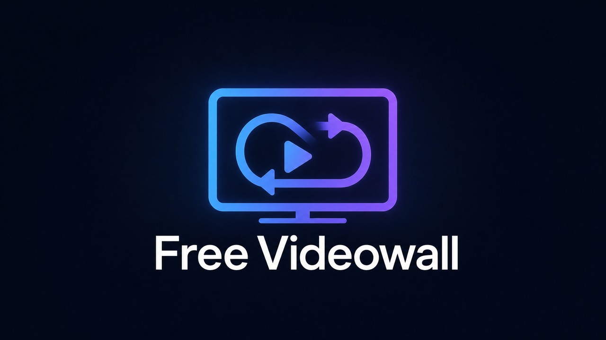

# Free Videowall



**Your USB stick. Your playlist. Just play.**

A free, open-source USB video and photo player for Roku devices with USB media support. No menus. No ads. No account inside the app. Put your files and an M3U playlist on a USB stick, open the app, and it plays them in a loop.

**Development preview:** not yet available in the Roku Streaming Store. Installation currently requires Roku developer mode. [Download the preview](https://github.com/gamma/free-roku-videowall/releases) · [Deutsch](README.de.md)

## Start here

1. Install the app using the [installation guide](docs/installation.md).
2. Put your videos and pictures on a compatible USB stick.
3. Create `playlist.m3u` at the top level of the stick.
4. Plug the stick into your Roku and open Free Videowall.

The app reads the list, plays it in order, and starts again after the last entry. Media can be in folders. Nothing is uploaded. The app itself does not fetch media from the internet.

## What is an M3U?

Just a text file listing what to play. Save this as **`playlist.m3u`**, using UTF-8, rather than `playlist.m3u.txt`:

```m3u
#EXTM3U
#EXTINF:-1,Play the whole video
videos/welcome.mp4
#EXTINF:10,Show this picture for ten seconds
pictures/offer.jpg
```

Your stick would contain:

```text
playlist.m3u
videos/
  welcome.mp4
pictures/
  offer.jpg
```

Use paths relative to the playlist. File names must match the files on the stick. `#EXTINF:-1` plays a whole video; a positive number limits playback to that many seconds. For pictures, the number is the display time; the default is ten seconds. JPG, JPEG and PNG pictures are supported. Video compatibility depends on your device; MP4 with H.264 video and AAC audio is a good starting point.

## Smooth transitions

The default picture blend lasts **1.5 seconds**, including the last-to-first transition. To set the outgoing blend for an entry:

```m3u
#EXTINF:-1,Welcome
#EXT-X-FADE:1.5
videos/welcome.mp4
```

For video transitions, prepare small start/end pictures once, while the stick is connected to your computer:

```sh
python3 scripts/prepare_usb.py /path/to/USB/playlist.m3u
```

Requires Python 3.9+ and [FFmpeg](https://ffmpeg.org/download.html). The helper adds `welcome.mp4.start.jpg` and `welcome.mp4.end.jpg` beside the video. Keep those files on the stick. Pictures need no preparation.

The blend uses the previous video's still end frame and the next video's still start frame. The incoming video runs underneath and becomes visible after the blend. It is not a dissolve between two moving videos. Audio is not crossfaded. Without the helper images, a video transition may briefly show black. See [playlist details](docs/playlist.md).

## Keep it simple

- No usable stick or playlist: black screen; the app retries every five seconds.
- Playlist changes are picked up at the next loop.
- USB launch support is declared; availability depends on the TV. Power-on autostart is not guaranteed.
- The preview suppresses the screensaver while open. TV sleep timers are separate.
- This is a player, not a locked kiosk. Roku Home and TV controls remain available.

Want a regular Store installation? See the [publishing status](docs/publishing.md). Bugs and suggestions: [GitHub Issues](https://github.com/gamma/free-roku-videowall/issues). Build instructions: [development](docs/development.md).

Remote: Back exits; Play toggles video pause, forward/rewind/replay request ten-second seeks. Roku system keys remain available. No custom controls are displayed. Device verification is still pending.

[Test status and device checks](docs/testing.md).

## License

Copyright 2026 Gerry Weißbach. [Apache License 2.0](LICENSE).

The license covers this project's code and documentation, not your media. Independent project; not affiliated with Roku, Inc.

Project website and GitHub Pages setup: [website guide](docs/website.md).

[Build a playlist visually](https://videowall.gh.gammaproduction.de/editor.html): paste filenames or an M3U, arrange videos and pictures, preview placeholders, download `playlist.m3u`. Runs locally in your browser.
